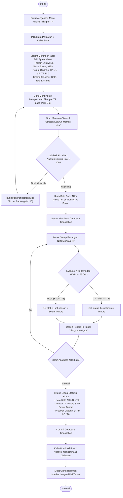
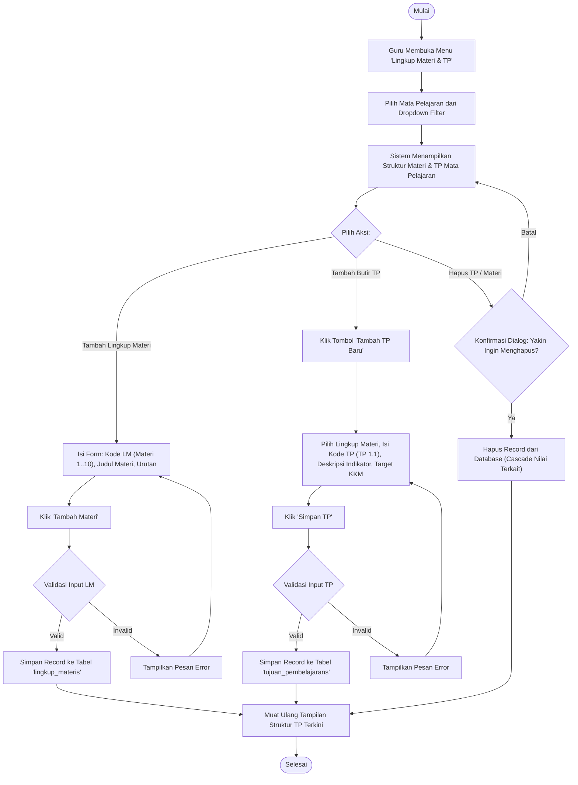
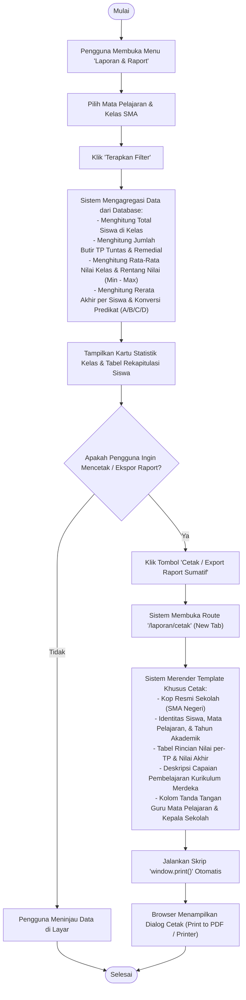
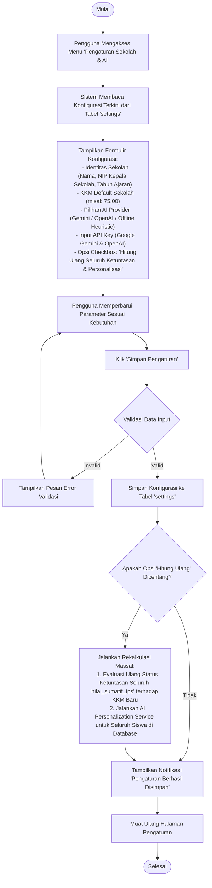

# Dokumen Spesifikasi Activity Diagram
## Sistem Asesmen Personalisasi Siswa SMA (Kurikulum Merdeka & AI Engine)

Dokumen ini memuat kumpulan **Activity Diagram** komprehensif dalam format Mermaid yang memodelkan alur kerja operasional, logika komputasi ketuntasan TP, integrasi AI Engine, dan siklus pelaporan sistem.

---

## Daftar Isi Activity Diagram
1. [AD-01: Alur Penilaian Matriks Sumatif per-TP (Spreadsheet Grid Entry)](#ad-01-alur-penilaian-matriks-sumatif-per-tp)
2. [AD-02: Alur Analisis Diagnostik & Personalisasi Pembelajaran AI](#ad-02-alur-analisis-diagnostik--personalisasi-pembelajaran-ai)
3. [AD-03: Alur Manajemen Lingkup Materi & Tujuan Pembelajaran (TP)](#ad-03-alur-manajemen-lingkup-materi--tujuan-pembelajaran)
4. [AD-04: Alur Rekapitulasi & Pencetakan Raport Kurikulum Merdeka](#ad-04-alur-rekapitulasi--pencetakan-raport-kurikulum-merdeka)
5. [AD-05: Alur Konfigurasi Sekolah & Manajemen Provider AI](#ad-05-alur-konfigurasi-sekolah--manajemen-provider-ai)

---

## AD-01: Alur Penilaian Matriks Sumatif per-TP

Activity diagram ini memodelkan proses input nilai massal menggunakan antarmuka tabel spreadsheet *grid*, validasi batas angka (0 - 100), penyimpanan *batch*, serta kalkulasi otomatis ketuntasan TP dan predikat akhir.

---

## AD-02: Alur Analisis Diagnostik & Personalisasi Pembelajaran AI

Activity diagram ini memodelkan bagaimana sistem mengolah data ketuntasan TP, performa agregat, dan gaya belajar VARK melalui model bahasa kecerdasan buatan (Gemini / OpenAI API) atau *smart heuristic fallback* secara otomatis.

```mermaid
flowchart TD
    Start(["Mulai"]) --> Trigger["Pemicu: Guru Membuka Detail Personalisasi Siswa / Klik 'Refresh Analisis AI'"]
    Trigger --> FetchStudent["Sistem Mengambil Data Siswa Terkait:
    - Profil Siswa (Nama, NISN, Gaya Belajar VARK)
    - Daftar Lengkap Butir TP Belum Tuntas (Remedial)
    - Daftar Butir TP Tuntas (Pengayaan)
    - Rata-Rata Nilai Sumatif & Mata Pelajaran Terkait"]
    
    FetchStudent --> CheckProvider{"Periksa Konfigurasi AI di Tabel Settings:
    Apakah Provider = 'gemini' / 'openai' dan API Key Terisi?"}
    
    %% Alur AI LLM (Online)
    CheckProvider -- Ya (API Key Ada) --> ComposePrompt["Susun System & User Prompt Pedagogis Kurikulum Merdeka:
    - Sertakan Daftar TP Belum Tuntas
    - Sertakan Gaya Belajar Siswa
    - Instruksikan Output JSON Terstruktur"]
    
    ComposePrompt --> SendAPIRequest["Kirim HTTP POST Request ke AI Endpoint (Gemini / OpenAI)"]
    SendAPIRequest --> AwaitResponse{"Apakah Respon HTTP 200 & Format JSON Valid?"}
    
    AwaitResponse -- Ya (Sukses) --> ParseJSON["Ekstraksi Data JSON dari LLM:
    - Kategori Pemahaman ('Tinggi' / 'Sedang' / 'Perlu Pendampingan')
    - Rekomendasi Modalitas Belajar
    - Analisis Diagnostik & Kendala
    - Rekomendasi Materi & Butir Remedial
    - Strategi Aktivitas & Pembelajaran Adaptif"]
    
    %% Alur Heuristik (Offline / Fallback)
    AwaitResponse -- Tidak / Error / Timeout --> LogError["Catat Log Peringatan API Error"]
    LogError --> RunFallback["Jalankan Smart Heuristic Engine (Offline Rule-Based)"]
    CheckProvider -- Tidak (Tanpa API Key) --> RunFallback
    
    RunFallback --> DeterministicCalc["Hitung Kategori berdasarkan Persentase Ketuntasan TP:
    - 100% Tuntas -> 'Tinggi'
    - Sebagian Belum Tuntas -> 'Sedang'
    - Mayoritas Belum Tuntas -> 'Perlu Pendampingan'"]
    
    DeterministicCalc --> GenerateRuleStrategy["Susun Rekomendasi Remedial & Strategi Diferensiasi berdasarkan Matriks VARK"]
    
    %% Tahap Penyimpanan & Presentasi
    ParseJSON --> SaveDB["Simpan / Perbarui Record di Tabel 'personalisasis':
    - siswa_id, skor_performa, kategori_pemahaman
    - analisis_kekuatan, analisis_kelemahan
    - rekomendasi_materi, rekomendasi_aktivitas"]
    GenerateRuleStrategy --> SaveDB
    
    SaveDB --> RenderView["Tampilkan Kartu Profil Diagnostik AI & Strategi Adaptif kepada Guru"]
    RenderView --> End(["Selesai"])
```

---

## AD-03: Alur Manajemen Lingkup Materi & Tujuan Pembelajaran

Activity diagram ini menggambarkan proses pendefinisian hirarki kurikulum dari mata pelajaran ke Lingkup Materi (Materi 1..10) hingga butir-butir indikator Tujuan Pembelajaran (TP).

---

## AD-04: Alur Rekapitulasi & Pencetakan Raport Kurikulum Merdeka

Activity diagram ini menggambarkan proses pembuatan laporan kumulatif capaian siswa dan pencetakan dokumen fisik/PDF raport sumatif.

---

## AD-05: Alur Konfigurasi Sekolah & Manajemen Provider AI

Activity diagram ini memodelkan alur konfigurasi identitas sekolah, nilai standar KKM, serta pengaturan integrasi kecerdasan buatan (Gemini / OpenAI).

