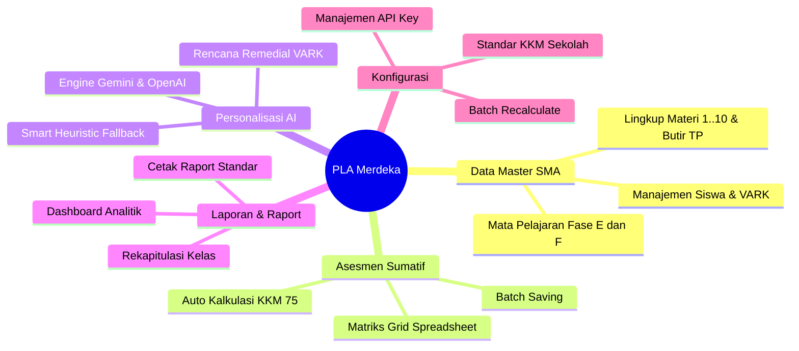
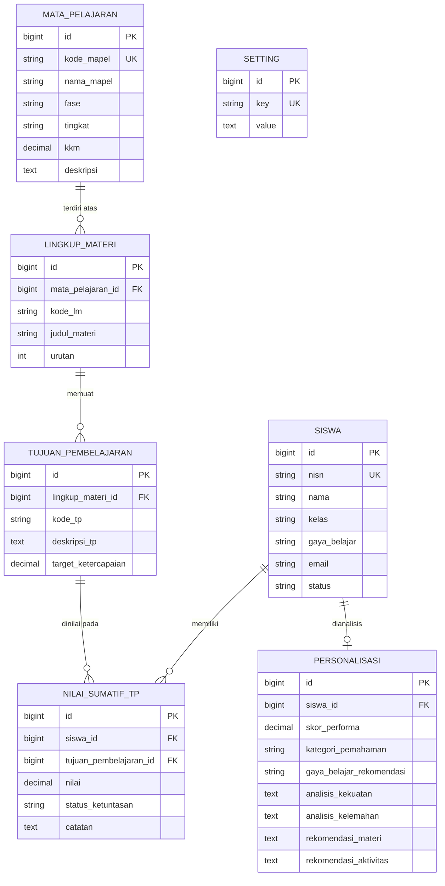

# Product Requirement Document (PRD)
## PLA Merdeka: Personalized Learning & Assessment Engine SMA
**Versi:** 1.0.0  
**Status:** Approved & Implemented  
**Target Platform:** Web Application (Laravel 12, Tailwind CSS v4, AI LLM Integration)  
**Target Kurikulum:** Kurikulum Merdeka SMA (Fase E & Fase F)

---

## 1. Executive Summary & Visi Produk

**PLA Merdeka (Personalized Learning & Assessment)** adalah platform asesmen sumatif dan mesin personalisasi pembelajaran cerdas yang dirancang khusus untuk jenjang **Sekolah Menengah Atas (SMA)** dalam ekosistem **Kurikulum Merdeka**. 

Sistem ini mentransformasi proses asesmen konvensional menjadi pendekatan berbasis data per **Tujuan Pembelajaran (TP)** yang terintegrasi dengan **AI Engine (Google Gemini / OpenAI)** dan **Modalitas Belajar VARK (Visual, Auditori, Kinestetik, Baca/Tulis)** guna menghasilkan rencana tindak lanjut remedial dan pengayaan yang adaptif secara instan.

### Visi Produk
> *"Mewujudkan asesmen sumatif yang adil, transparan, dan berpusat pada murid melalui diagnostik butir Tujuan Pembelajaran serta intervensi pembelajaran berdiferensiasi berbasis kecerdasan buatan."*

---

## 2. Latar Belakang & Problem Statement

### 2.1 Konteks Kurikulum Merdeka
Pada Kurikulum Merdeka jenjang SMA:
1. Penilaian hasil belajar tidak lagi didasarkan pada satu angka akumulatif tunggal (UTS/UAS umum), melainkan pada ketercapaian setiap butir **Tujuan Pembelajaran (TP)** dalam setiap **Lingkup Materi (Materi 1..10)**.
2. Siswa yang belum mencapai Kriteria Ketercapaian Tujuan Pembelajaran (KKTP / KKM $\ge 75$) wajib mendapatkan program **remedial spesifik** hanya pada butir TP yang belum tuntas, bukan mengulang seluruh materi.
3. Guru diwajibkan menerapkan **Pembelajaran Berdiferensiasi** yang mengakomodasi keberagaman profil dan gaya belajar siswa.

### 2.2 Permasalahan yang Dihadapi Guru & Sekolah
- **Beban Administrasi Tinggi:** Merekap puluhan butir TP untuk puluhan siswa dalam satu kelas menggunakan spreadsheet manual sangat rawan kesalahan input (*human error*).
- **Kesulitan Menentukan Tindak Lanjut Spesifik:** Guru kesulitan memetakan secara cepat siswa mana yang gagal di TP apa dan bentuk intervensi apa yang cocok dengan gaya belajarnya.
- **Ketiadaan Asisten Cerdas:** Guru membutuhkan waktu lama untuk menyusun narasi diagnostik rapor dan strategi pembelajaran remedial yang sesuai kaidah pedagogik Kurikulum Merdeka.

---

## 3. Persona Pengguna (User Personas)

### Persona 1: Guru Mata Pelajaran SMA (Primary User)
- **Profil:** Ibu Sri Rahayu, S.Pd. (Guru Biologi & PJ Asesmen Kelas X SMA)
- **Tujuan:** Menginput nilai puluhan TP dengan cepat seperti di Excel, mengetahui butir TP mana yang belum tuntas, dan mendapatkan rekomendasi strategi remedial otomatis untuk siswa.
- **Pain Point:** Rumitnya merekap nilai puluhan butir TP dan keterbatasan waktu menyusun modul remedial berdiferensiasi.

### Persona 2: Koordinator Kurikulum & Kepala Sekolah (Secondary User)
- **Profil:** Bapak Joko Susilo, M.Pd. (Wakil Kepala Sekolah Bidang Kurikulum)
- **Tujuan:** Memantau distribusi ketuntasan belajar kelas/sekolah, mengevaluasi efektivitas TP, dan mencetak laporan raport sumatif resmi sesuai format standar nasional.
- **Pain Point:** Sulitnya memperoleh rekapitulasi data capaian TP kelas secara *real-time*.

### Persona 3: Siswa SMA (Beneficiary)
- **Profil:** Almira Pradipta (Siswa Kelas X-A SMA, Gaya Belajar: Visual)
- **Tujuan:** Mengetahui secara transparan butir kompetensi yang belum dikuasai dan mendapatkan materi remedial visual yang mudah dipahami.

---

## 4. Tujuan & Metrik Keberhasilan (Goals & KPIs)

| Metrik | Target Keberhasilan |
|:---|:---|
| **Waktu Input & Rekap Nilai** | Mengurangi waktu rekapitulasi nilai TP guru hingga **>75%** melalui antarmuka spreadsheet matrix. |
| **Akurasi Ketuntasan TP** | **100%** kalkulasi status ketuntasan (Tuntas/Belum Tuntas) dan predikat (A/B/C/D) terotomatisasi tanpa salah hitung. |
| **Respon Diagnostik AI** | Hasil analisis diagnostik dan rekomendasi personalisasi VARK tergenerasi dalam **< 3 detik**. |
| **Ketersediaan Layanan (Reliability)** | **99.9%** ketersediaan berkat fitur *Smart Heuristic Fallback* otomatis saat jaringan eksternal/API bermasalah. |

---

## 5. Fitur Utama & Spesifikasi Fungsional (Functional Requirements)

---

### FR-01: Modul Data Master Kurikulum
- **FR-01.1 (Manajemen Siswa):** Registrasi identitas siswa SMA (NISN, Nama, Kelas X/XI/XII, Email, Status Aktif) dan modalitas gaya belajar VARK (Visual, Auditori, Kinestetik, Baca/Tulis).
- **FR-01.2 (Manajemen Mata Pelajaran):** Pengaturan kode mapel, nama mapel, Fase Kurikulum (**Fase E** untuk Kelas X, **Fase F** untuk Kelas XI-XII), tingkat kelas, KKM default (75.00), dan deskripsi capaian pembelajaran.
- **FR-01.3 (Hirarki Lingkup Materi & TP):** 
  - Struktur materi berjenjang (Materi 1 s.d. Materi 10).
  - Pendaftaran butir-butir indikator Tujuan Pembelajaran (TP 1.1, TP 1.2, dst.) di bawah lingkup materi terkait beserta target ketercapaian masing-masing.
  - Filter pemilihan mata pelajaran menggunakan dropdown interaktif.

---

### FR-02: Spreadsheet Grid Matrix Assessment Engine
- **FR-02.1 (Antarmuka Matriks Spreadsheet):**
  - Tampilan grid responsif dengan kolom *sticky* (No, Nama Siswa, NISN) yang rapat tanpa jeda kosong (*gap-free*).
  - Kolom dinamis horizontal untuk setiap butir TP (TP 1.1 s.d. TP 10.2).
  - Input box angka (rentang validasi 0 - 100) yang mendukung navigasi cepat.
- **FR-02.2 (Kalkulasi Otomatis Ketuntasan):**
  - Skor $\ge 75.00 \rightarrow$ Status **Tuntas** (Badge Hijau).
  - Skor $< 75.00 \rightarrow$ Status **Belum Tuntas / Perlu Remedial** (Badge Merah).
- **FR-02.3 (Batch Processing):** Tombol *"Simpan Seluruh Matriks Nilai"* dengan icon SVG standar yang menyimpan seluruh matriks nilai siswa dalam satu transaksi database (`Database Transaction`).

---

### FR-03: AI-Powered Adaptive Diagnostic & Personalization Engine
- **FR-03.1 (Multi-Provider AI Architecture):**
  - Dukungan utama: **Google Gemini API** (`gemini-1.5-flash` / `gemini-2.0-flash`).
  - Dukungan alternatif: **OpenAI API** (`gpt-4o-mini`).
  - Dukungan offline: **Smart Heuristic Fallback Engine** yang berjalan otomatis jika API key kosong atau jaringan offline.
- **FR-03.2 (Struktur Output Diagnostik AI):**
  - **Kategori Pemahaman:** *Tinggi (Pengayaan)*, *Sedang (Optimal)*, *Perlu Pendampingan (Remedial)*.
  - **Rekomendasi Gaya Belajar:** Penyesuaian modalitas VARK berdasarkan tren capaian materi.
  - **Analisis Kekuatan & Kelemahan:** Diagnostik butir TP mana yang dikuasai dan butir TP mana yang menjadi kendala utama.
  - **Rekomendasi Butir Remedial:** Pemetaan langsung butir TP yang harus diujikan ulang.
  - **Strategi Pembelajaran Adaptif:** Instruksi konkret diferensiasi konten, proses, dan produk pembelajaran.
- **FR-03.3 (Batch & Single Regeneration):** Opsi refresh analisis AI untuk satu siswa tertentu atau seluruh siswa di kelas sekaligus.

---

### FR-04: Dashboard Analitik & Monitoring Kelas
- **FR-04.1 (Visualisasi Statistik):** 
  - Chart donat distribusi kategori pemahaman (*Tinggi, Sedang, Perlu Pendampingan*).
  - Chart bar modalitas gaya belajar siswa (VARK).
- **FR-04.2 (At-Risk Remedial Alert):** Panel khusus siswa yang memerlukan bimbingan remedial segera lengkap dengan jumlah TP belum tuntas.
- **FR-04.3 (Quick Access):** Tautan langsung ke matriks penilaian lengkap dan profil personalisasi siswa.

---

### FR-05: Laporan & Cetak Raport Kurikulum Merdeka
- **FR-05.1 (Rekapitulasi Kelas):** Agregasi total siswa, ketuntasan butir TP, rata-rata kelas, dan rentang nilai minimum-maksimum.
- **FR-05.2 (Tabel Capaian & Predikat):**
  - Predikat A (Sangat Baik): Nilai $\ge 90.00$
  - Predikat B (Baik): $80.00 \le \text{Nilai} < 90.00$
  - Predikat C (Cukup / Tuntas): $75.00 \le \text{Nilai} < 80.00$
  - Predikat D (Perlu Bimbingan / Remedial): $\text{Nilai} < 75.00$
- **FR-05.3 (Cetak / Ekspor Raport Standar):**
  - Tata letak dokumen resmi siap cetak (*print-ready layout* / `window.print()`).
  - Kop resmi SMA, data siswa, rincian skor per-TP, nilai akhir, predikat, deskripsi ketercapaian, dan kolom pengesahan tanda tangan Guru Pengampu & Kepala Sekolah.

---

### FR-06: Pengaturan Sistem Sekolah & AI
- **FR-06.1 (Identitas Institusi):** Nama SMA, tahun ajaran/semester, nama & NIP Kepala Sekolah, serta kurikulum aktif.
- **FR-06.2 (Ambang Batas KKM):** Pengaturan standar KKM default sekolah.
- **FR-06.3 (Konfigurasi Provider & Kunci API):** Pilihan AI Provider dan input API Key dengan sensor keamanan.
- **FR-06.4 (Mass Recalculate Trigger):** Opsi *checkbox* untuk menghitung ulang seluruh status ketuntasan nilai di database dan memperbarui profil personalisasi AI secara massal.

---

## 6. Kebutuhan Non-Fungsional (Non-Functional Requirements)

### 6.1 Desain Antarmuka & UX (Design System)
- **Komponen Global Blade Reusable:** Menggunakan komponen blade terstandarisasi di `resources/views/components/` (`<x-page-header>`, `<x-card>`, `<x-search-input>`, `<x-filter-select>`, `<x-table>`, `<x-button>`, `<x-empty-state>`).
- **Sidebar & Icon:** Menggunakan icon vektor SVG monokromatik netral (Heroicons) tanpa emotikon.
- **Responsivitas:** Antarmuka adaptif untuk berbagai resolusi layar (desktop, laptop, dan tablet).

### 6.2 Performa & Kecepatan
- Waktu respon pemuatan halaman rata-rata **< 150 ms**.
- Waktu kompilasi asset frontend (Vite) **< 1.5 detik**.
- Database query teroptimasi menggunakan *eager loading* (`with(['lingkupMateris.tujuanPembelajarans'])`) untuk mencegah masalah *N+1 query*.

### 6.3 Keamanan Data
- Proteksi terhadap serangan **CSRF** pada seluruh formulir mutasi data.
- Proteksi terhadap **SQL Injection** melalui query builder parameter binding dan Eloquent ORM.
- Validasi ketat sisi server (`FormRequest` & validator) untuk seluruh input data numerik (0 - 100) dan teks.

---

## 7. Model Data & Skema Database

---

## 8. Verifikasi & Pengujian Kualitas

| Aspek Pengujian | Alat Pengujian | Kriteria Lolos | Status |
|:---|:---|:---|:---|
| **Feature & Unit Tests** | PHPUnit / Laravel Test Suite | 13 Test Case, 82 Assertions, 0 Failure | **PASSED (100%)** |
| **Asset Compilation** | Vite & Tailwind CSS v4 | CSS & JS bundle compiled without errors | **PASSED (100%)** |
| **Browser Live Verification** | Subagent Browser Interactive Testing | Seluruh halaman terverifikasi fungsional | **PASSED (100%)** |

---

## 9. Roadmap Masa Depan (Future Roadmap)

- **Fase 2 (Q4):** 
  - Portal Siswa Mandiri untuk melihat progres ketuntasan TP dan latihan soal formatif interaktif.
  - Rekomendasi media belajar AI berbasis video / audio otomatis untuk siswa tipe Auditori & Kinestetik.
- **Fase 3 (Q1):** 
  - Fitur Import / Export Excel (.xlsx) dua arah untuk kemudahan migrasi data dari Dapodik.
  - Integrasi API ke e-Rapor Nasional Kemendikbudristek.
