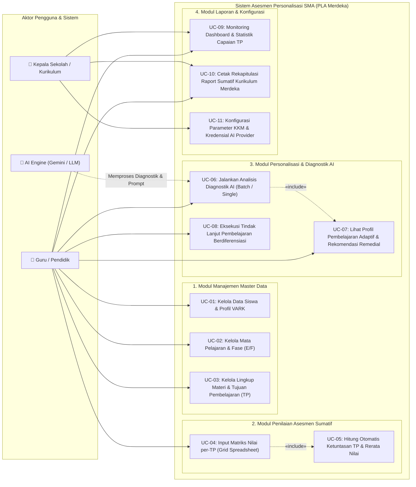

# Dokumen Spesifikasi & Use Case Diagram
## Sistem Asesmen Personalisasi Siswa SMA (Kurikulum Merdeka & AI Engine)

Dokumen ini mendeskripsikan secara lengkap pemodelan **Use Case Diagram**, deskripsi aktor, dan spesifikasi skenario interaksi pengguna pada sistem asesmen personalisasi siswa SMA berbasis Kurikulum Merdeka.

---

## 1. Use Case Diagram (Mermaid)

---

## 2. Deskripsi Aktor

| No | Aktor | Tipe | Deskripsi Peran |
|:---|:---|:---|:---|
| 1 | **Guru / Pendidik** | *Primary Actor (Human)* | Memasukkan dan mengelola data master siswa, tujuan pembelajaran, menginput skor asesmen sumatif melalui matriks grid, memicu analisis diagnostik AI, serta melihat rekomendasi pembelajaran adaptif untuk remedial/pengayaan. |
| 2 | **Kepala Sekolah / Tim Kurikulum** | *Secondary Actor (Human)* | Memantau statistik ketuntasan belajar secara holistik melalui dashboard analitik, melihat dan mencetak laporan raport ketercapaian TP, serta mengonfigurasi parameter KKM dan kredensial AI sekolah. |
| 3 | **AI Engine (Gemini / OpenAI / Heuristic)** | *System Actor (Service)* | Memproses data nilai sumatif per butir TP, gaya belajar VARK, dan profil performa siswa guna menghasilkan analisis diagnostik, pemetaan akar masalah, serta strategi pembelajaran berdiferensiasi secara terstruktur. |

---

## 3. Spesifikasi Rinci Use Case

### UC-01: Kelola Data Siswa & Profil Gaya Belajar (VARK)
- **Aktor:** Guru
- **Deskripsi:** Menambah, melihat, mengubah, menyaring, dan menghapus data identitas siswa SMA beserta hasil asesmen awal modalitas belajar (Visual, Auditori, Kinestetik, Baca/Tulis).
- **Pra-kondisi:** Guru telah masuk ke dalam sistem.
- **Alur Utama:**
  1. Guru mengakses menu "Data Siswa SMA".
  2. Sistem menampilkan daftar siswa dengan filter kelas, modalitas VARK, status, dan pencarian.
  3. Guru dapat menekan tombol "Tambah Siswa Baru", mengisi formulir (NISN, Nama, Kelas, Gaya Belajar, Email), lalu menyimpan.
  4. Sistem memvalidasi keunikan NISN dan menyimpan data ke database.
- **Pasca-kondisi:** Profil siswa tersimpan dan siap dipetakan dalam asesmen sumatif.

---

### UC-02: Kelola Mata Pelajaran & Fase Kurikulum (E/F)
- **Aktor:** Guru, Tim Kurikulum
- **Deskripsi:** Mengelola daftar mata pelajaran SMA berdasarkan fase kurikulum (Fase E untuk Kelas X, Fase F untuk Kelas XI-XII) dan menentukan ambang batas KKM/KKTP.
- **Alur Utama:**
  1. Pengguna membuka menu "Mata Pelajaran".
  2. Pengguna mengisi kode mapel, nama mapel, fase kurikulum, tingkat kelas, standar KKM (default 75.00), dan deskripsi capaian.
  3. Sistem menyimpan dan mengasosiasikan mata pelajaran dengan struktur kurikulum.

---

### UC-03: Kelola Lingkup Materi & Tujuan Pembelajaran (TP)
- **Aktor:** Guru
- **Deskripsi:** Menata hirarki materi pembelajaran (Materi 1 s.d. Materi 10) dan mendaftarkan butir-butir indikator Tujuan Pembelajaran (TP) yang dinilai.
- **Alur Utama:**
  1. Guru memilih mata pelajaran melalui dropdown filter.
  2. Guru menambahkan Lingkup Materi (contoh: *Materi 1 - Struktur Sel dan Jaringan*).
  3. Guru menambahkan butir Tujuan Pembelajaran di bawah lingkup materi terkait (contoh: *TP 1.1 - Mengidentifikasi organel sel hewan dan tumbuhan*).
- **Pasca-kondisi:** Struktur TP terbentuk dan menjadi kolom input pada matriks nilai.

---

### UC-04: Input Matriks Nilai Sumatif per-TP (Spreadsheet Grid) & Auto Kalkulasi
- **Aktor:** Guru
- **Deskripsi:** Memasukkan nilai angka (0 - 100) untuk seluruh siswa dan seluruh butir TP secara simultan dalam antarmuka tabel spreadsheet interaktif.
- **Alur Utama:**
  1. Guru membuka menu "Matriks Nilai per-TP" dan memilih mata pelajaran serta kelas.
  2. Sistem menampilkan spreadsheet grid dengan kolom *sticky* (No, Nama Siswa, NISN) dan kolom dinamis untuk setiap butir TP (TP 1.1 s.d. TP 10.2).
  3. Guru menginput atau mengedit nilai siswa.
  4. Guru menekan tombol "Simpan Seluruh Matriks Nilai".
  5. Sistem secara otomatis:
     - Menyimpan batch nilai ke tabel `nilai_sumatif_tps`.
     - Menentukan status ketuntasan per butir TP (Nilai $\ge$ 75 $\rightarrow$ *Tuntas*, Nilai < 75 $\rightarrow$ *Belum Tuntas / Remedial*).
     - Menghitung rata-rata sumatif akhir siswa dan menentukan predikat belajar (A / B / C / D).

---

### UC-06: Jalankan Analisis Diagnostik & Personalisasi AI
- **Aktor:** Guru, AI Engine
- **Deskripsi:** Menganalisis ketuntasan TP siswa dan modalitas belajarnya menggunakan Large Language Model (Google Gemini API / OpenAI API) atau Smart Heuristic Engine.
- **Alur Utama:**
  1. Guru menekan tombol "Refresh Analisis AI Seluruh Siswa" atau "Analisis Ulang dengan AI" pada detail siswa tertentu.
  2. Sistem mengagregasi data siswa: daftar butir TP yang belum tuntas, skor rata-rata, dan gaya belajar VARK.
  3. Sistem menyusun *structured prompt* pedagogis dan memanggil API AI.
  4. AI Engine merespons dengan format JSON yang berisi:
     - Kategori Pemahaman (*Tinggi / Sedang / Perlu Pendampingan*)
     - Rekomendasi Modalitas Belajar
     - Analisis Diagnostik & Akar Kendala
     - Rekomendasi Butir Materi Remedial
     - Strategi Aktivitas & Pembelajaran Adaptif (Diferensiasi Proses, Konten, Produk)
  5. Sistem menyimpan hasil analisis ke tabel `personalisasis`.

---

### UC-07: Lihat Profil Pembelajaran Adaptif & Rekomendasi Remedial
- **Aktor:** Guru
- **Deskripsi:** Membaca hasil analisis diagnostik personal, melihat breakdown butir TP remedial, dan mengunduh atau menyalin rencana intervensi belajar siswa.
- **Alur Utama:**
  1. Guru membuka halaman "Detail Personalisasi Siswa".
  2. Sistem menyajikan kartu profil diagnostik lengkap dengan *badge* kategori, ringkasan ketuntasan TP, akar masalah, dan rincian langkah aktivitas pembelajaran adaptif.

---

### UC-10: Cetak Rekapitulasi Raport Sumatif Kurikulum Merdeka
- **Aktor:** Guru, Kepala Sekolah
- **Deskripsi:** Menghasilkan dokumen cetak resmi (print-ready / PDF) berformat standar kurikulum nasional yang memuat capaian nilai seluruh TP, predikat, dan status ketuntasan.
- **Alur Utama:**
  1. Pengguna membuka menu "Laporan & Raport".
  2. Pengguna memilih mata pelajaran dan kelas SMA.
  3. Pengguna menekan tombol "Cetak / Export Raport Sumatif".
  4. Sistem merender halaman cetak dengan tata letak dokumen formal lengkap dengan kop sekolah, tabel capaian TP, dan kolom tanda tangan pengesahan.

---

### UC-11: Konfigurasi Parameter KKM & Kredensial AI Provider
- **Aktor:** Tim Kurikulum / Administrator
- **Deskripsi:** Mengatur parameter umum institusi sekolah, nilai standar KKM/KKTP, serta memilih provider AI aktif (Google Gemini, OpenAI, atau Offline Fallback) dan API key yang digunakan.
